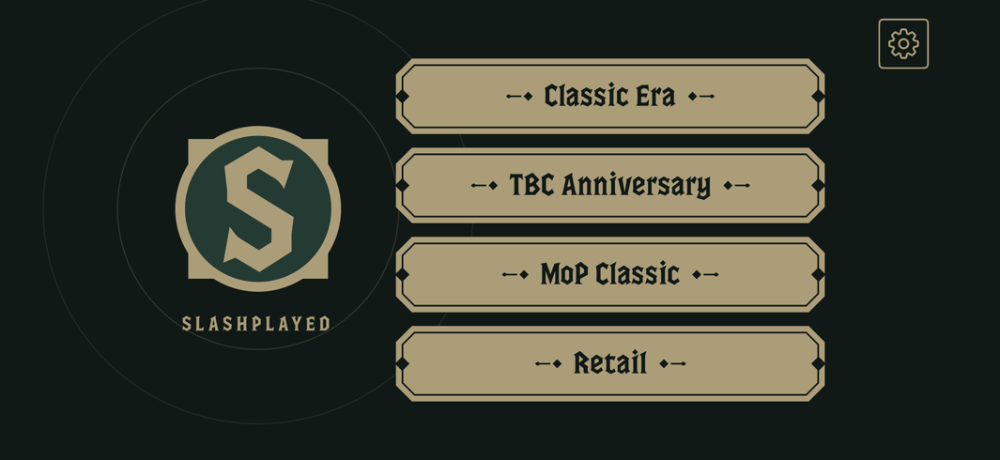

# Slashplayed

**World of Warcraft on your iPad, iPhone, and Apple Vision Pro.**

Slashplayed runs Blizzard's official Mac client, unmodified, directly on your device. Its Apple
Silicon code runs natively, and missing macOS frameworks are translated to their mobile OS
equivalents. Set up once using your Mac, then play untethered.

  

> **Unofficial and at your own risk.** Slashplayed isn't affiliated with or endorsed by Blizzard
> Entertainment. It includes no Blizzard files: the game downloads from Blizzard, and you need your
> own Battle.net account and subscription. Blizzard doesn't support playing this way, and your
> account could be actioned. It's early, and a game patch can break it until Slashplayed catches up.

## Games and devices

Every World of Warcraft game Battle.net offers for the Mac: **Classic Era** (Hardcore and Season of
Discovery included: switch the game mode in game), **TBC Anniversary**, **Mists of Pandaria
Classic**, and **Retail**. They run on an **iPad** with M1 or later, an **iPhone 15 Pro** or later,
and **Apple Vision Pro**. M1 iPads (the 2021 iPad Pros and the 5th-generation iPad Air) are untested:
Slashplayed has only been played on M2 and later. If you try one, please
[report how it goes](https://github.com/paulstraw/slashplayed/issues/new/choose), working or not,
with the zip from the companion's **Help > Export Diagnostics…**.
In-game voice chat isn't supported on the device yet
([#12](https://github.com/paulstraw/slashplayed/issues/12)).

## Requirements

- An **Apple Silicon Mac** with macOS 15 or later and Xcode. No Mac? For an iPad or iPhone, a tool for
  Windows and Linux is in testing: see [Setting up without a Mac](docs/setup-without-a-mac.md).
  Vision Pro needs a Mac.
- An **Apple ID signed in to Xcode**. A free one works, and the app is signed again every 7 days; a
  paid Apple Developer Program membership signs it for a year.
- Your device on **iPadOS 26, iOS 26, or visionOS 27**. Setup walks you through pairing it with the
  Mac and turning on Developer Mode.
- A **Battle.net account** with an active World of Warcraft subscription. The game doesn't need to be
  installed on the Mac.
- On iPhone and iPad, **drag on either half** for floating sticks, tap to click, and hold still to
  right-click. Configure sticks and custom buttons in **Settings > Touch Controls**.
  **Tap with four fingers together** for the keyboard and a text box with copy/paste.
  Vision Pro needs a hardware keyboard for game text. On an iPhone, a mouse needs
  AssistiveTouch on.
- **[LocalDevVPN](https://apps.apple.com/app/id6755608044)**, free on the App Store, turned on when
  the game starts.
- **Free space** on the device:

  | Game | Space |
  |---|---|
  | Classic Era | ~25 GB |
  | Classic Era + TBC Anniversary | ~37 GB |
  | Mists of Pandaria Classic | ~150 GB |
  | Retail | ~150 GB |

  A game grows toward these sizes as you play. Retail on an iPad or iPhone needs a 512 GB device
  with 8 GB of memory.

## Get started

1. Download **Slashplayed Companion** from the
   [latest release](https://github.com/paulstraw/slashplayed/releases/latest) and drag it to
   Applications.
2. Open it. Its setup assistant walks you through Xcode, your Apple ID, your device, LocalDevVPN, and
   your games, then installs Slashplayed on the device.
3. Open Slashplayed on the device and tap a game. The first start takes a few minutes while the game
   downloads its data from Blizzard; after that, it fetches each zone as you reach it.
4. Sign in with your Battle.net email and password. Slashplayed keeps them in the device's keychain,
   so you sign in once. For an authenticator code on iPhone or iPad, tap with four fingers together,
   type or paste the code, and tap Return. A hardware keyboard works too.
5. From then on, play from the device alone. Turn on **Update Games on This Device** in the
   companion's Settings, and the device installs Blizzard's patches itself, too.

Leaving the game for more than about 30 seconds (closing its window, taking off the headset, or
switching apps) can disconnect it. Use **Exit** or **Log Out** first to keep that session's settings.

The [guide](docs/guide.md) covers the rest: playing from the Mac, copying game files over, addons,
and free and paid Apple IDs. Something wrong? See [troubleshooting](docs/troubleshooting.md), then
[report an issue](https://github.com/paulstraw/slashplayed/issues/new/choose) with the zip from the
companion's **Help > Export Diagnostics…**.

## How it works

The companion downloads the Mac client from Blizzard, rewrites its load commands to point at
Slashplayed's shim libraries, and signs it with your Apple ID. On the device, the shims stand in for
AppKit, CoreAudio, and the other macOS frameworks, and a small helper prepares the client's
executable memory under TXM at each launch (that's what LocalDevVPN is for).
[architecture.md](docs/architecture.md) has the whole pipeline, and [research.md](docs/research.md)
the experiments behind it.

## Contributing

Bug reports, patch reports, and pull requests are welcome: [CONTRIBUTING.md](CONTRIBUTING.md) covers
them and building from source. Report security issues privately, as [SECURITY.md](SECURITY.md)
explains.

## License

[MIT](LICENSE). Copyright (c) 2026 Straw Dynamics. The third-party licenses ship in the companion
(About Slashplayed Companion > Acknowledgements) and in the device app.

World of Warcraft and Battle.net are trademarks of Blizzard Entertainment, Inc. Apple Vision Pro,
iPad, iPhone, visionOS, iPadOS, iOS, macOS, and Xcode are trademarks of Apple Inc.
