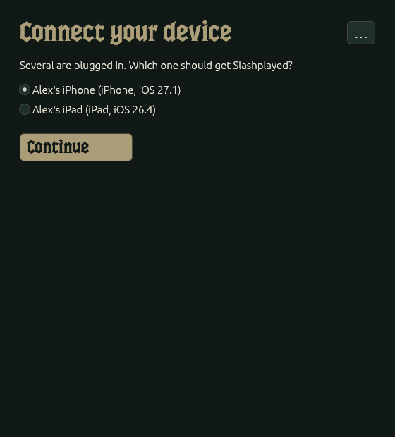
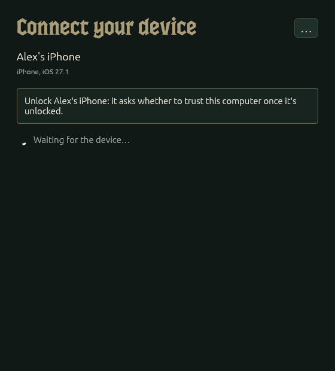
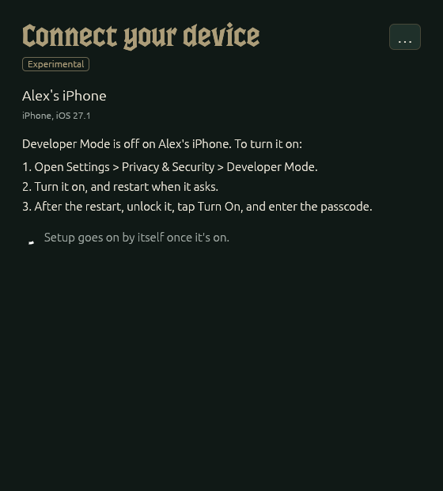
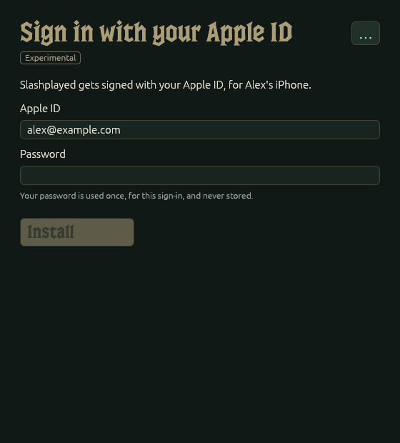
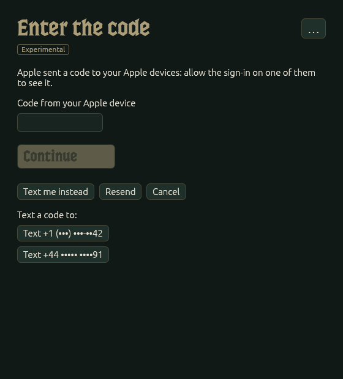
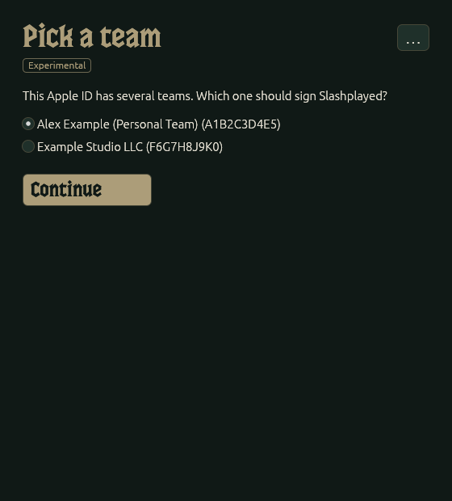
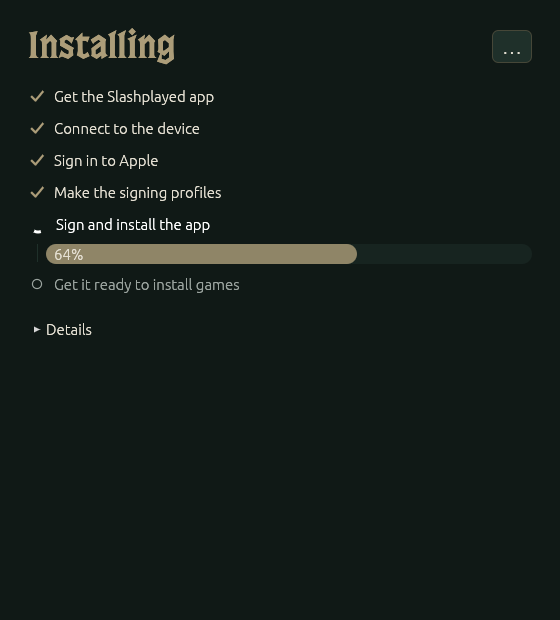
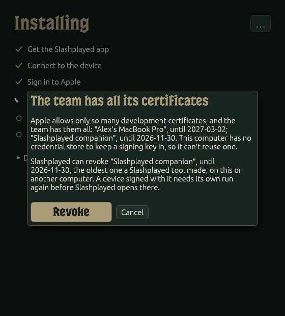
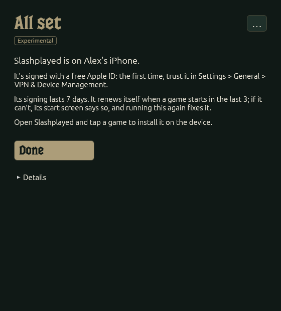
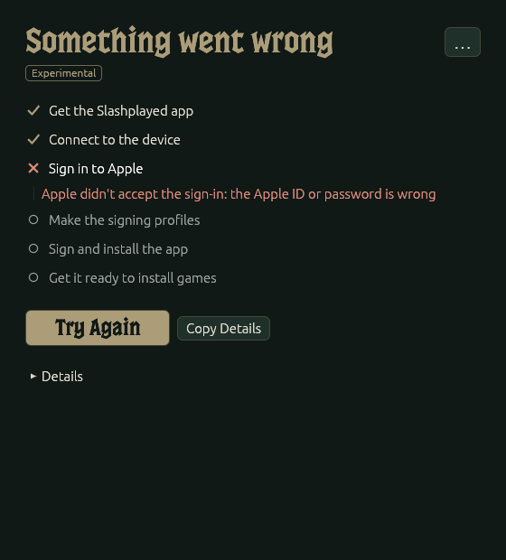

# Setting up without a Mac

The **Slashplayed Companion for Windows and Linux** sets up Slashplayed on an **iPad or iPhone** from a
PC, with no Mac. It's a window that walks you through it: plug in the device, sign in with your Apple ID,
and it installs the app. **slashplayed-cli**, in the same download, does the same from a terminal (see
[From the command line](#from-the-command-line)).

**Apple Vision Pro still needs a Mac** with the [Slashplayed Companion](../README.md#get-started).

## What it does

It does what the Mac companion does with Xcode:
- Signs in to your Apple ID.
- Makes the app's signing profiles.
- Signs Slashplayed and installs it over USB.
- Gets the app ready to install games: its pairing record for starting games without a computer, and
  the developer disk image.
- Gives the app an Apple token, so it can renew its own signing profiles from Apple.

You install the games on the device itself: open Slashplayed and tap one.

## Before you start

- **Your device:** an iPad with M1 or later or the A17 Pro iPad mini, or an iPhone 15 Pro or later, on
  iPadOS 26 or iOS 26 or later, with a USB cable.
- **Your computer:**
  - **Windows:** a 64-bit x86 PC, with **Apple Devices** from the Microsoft Store (or iTunes
    from apple.com) installed: it brings the driver that reaches the device.
  - **Linux:** x86_64 or ARM (aarch64), with glibc 2.35 or newer (Ubuntu 22.04 and its era, or later), an
    X11 or Wayland desktop with OpenGL, and **usbmuxd** installed and running (most distributions
    package it).
- **An Apple ID.**
  - **A free one works.** Its signing lasts 7 days, and Slashplayed renews it on the device itself when
    you play in the last 3 days before it runs out. A paid Apple Developer Program membership signs it
    for a year.
  - **Use a secondary Apple ID for a free team.** The companion signs in the way sideloading tools do,
    which Apple doesn't officially support.
- **[LocalDevVPN](https://apps.apple.com/app/id6755608044)** from the App Store, on when a game starts,
  and a **Battle.net account** with an active World of Warcraft subscription, as for the Mac way (see the
  [README's requirements](../README.md#requirements)).

## Running it

1. Download the archive for your system from the
   [latest release](https://github.com/paulstraw/slashplayed/releases/latest):
   - **Windows:** [`slashplayed-companion-windows-x86_64.zip`](https://github.com/paulstraw/slashplayed/releases/latest/download/slashplayed-companion-windows-x86_64.zip)
   - **Linux (x86_64):** [`slashplayed-companion-linux-x86_64.tar.gz`](https://github.com/paulstraw/slashplayed/releases/latest/download/slashplayed-companion-linux-x86_64.tar.gz)
   - **Linux (ARM):** [`slashplayed-companion-linux-aarch64.tar.gz`](https://github.com/paulstraw/slashplayed/releases/latest/download/slashplayed-companion-linux-aarch64.tar.gz)
2. Extract it, and keep the folder's files together: the window reads `Goodmountain-Regular.otf` from
   beside itself.
   - **Windows:** right-click the zip, choose **Extract All…**, and open the folder it makes. Opening the
     `.exe` from inside the zip, without extracting it, leaves the font behind.
   - **Linux:** `tar xzf slashplayed-companion-linux-*.tar.gz`, then `cd slashplayed-companion-linux-*`.
3. Open the window:
   - **Windows:** double-click **Slashplayed Companion.exe**. It isn't signed, so SmartScreen may say
     Windows protected your PC: choose **More info**, then **Run anyway**.
   - **Linux:** run `./slashplayed-companion` in the folder, from your desktop session.

The window then takes you through these screens.

### Your device

Plug in the iPad or iPhone with its cable and unlock it. With several plugged in, pick the one that
should get Slashplayed.

The companion waits for the device as long as it needs, and goes on by itself:
- **Locked:** unlock it.
- **Trust This Computer?** On the device, tap **Trust** and enter its passcode.
- **Developer Mode off:** on the device, open **Settings > Privacy & Security > Developer Mode**, turn it
  on, and restart when it asks. After the restart, unlock it, tap **Turn On**, and enter the passcode.

  
  

### Your Apple ID

Type your Apple ID and its password, then **Install**. The password is used once, for this sign-in, and
never stored.

Then type the code Apple sends to your Apple devices (allow the sign-in on one of them to see it).
**Text me instead** sends it by text to one of your trusted numbers, **Resend** sends another, and
**Cancel** stops the sign-in.

If the Apple ID has several teams, pick the one that should sign Slashplayed. With one team, this screen
doesn't show.

### Installing

The companion makes the signing profiles, signs the app, and installs it, showing each step. Copying the
app to the device takes a minute or two. **Details** shows what it did.

When the team has all the development certificates Apple allows, the companion makes room by revoking
the oldest one a Slashplayed tool made, never one made by Xcode or another app. With a credential store
(see [What it keeps](#what-it-keeps)) it does that without asking, at most once per computer, since the
certificate is reused after. With no credential store it would do it every run, so it asks first:
**Revoke** revokes that oldest one, and **Cancel** stops with nothing revoked. Either way, a device signed
with the revoked certificate needs its own run again before Slashplayed opens there.

### All set

On a **free Apple ID**, the first time only, open **Settings > General > VPN & Device Management** on the
device and trust your Apple ID, or the app won't open. Then open Slashplayed and tap a game to install it.

### When something goes wrong

The step that failed says why. **Try Again** starts the run over, from the device, and asks for your
password again. **Copy Details** copies what happened, for an issue (it never holds your password). More is under [Troubleshooting](#troubleshooting).

**Forget this computer's signing key…**, in the window's **…** menu, deletes the signing key the
companion keeps for an Apple ID (see [What it keeps](#what-it-keeps)).

### Keeping it signed

Slashplayed keeps its own signing up to date: when a game starts in the last 3 days before it runs out,
the app gets new signing profiles from Apple, over the internet, with the token the companion gave it. If
it can't, the start screen says so from then on, and on which day the app stops opening (only once a game
has started in those 3 days: nothing checks before then). Then run the companion again, the same way,
before that day, or tap **Sign In to Apple…** under that note and sign in on the device itself (optional:
a second sign-in to your Apple ID through the same kind of anisette server as the companion's). Your
games and settings stay.

## Checking a download

The builds aren't signed, so you can check them two ways:
- **Its checksum:** compare the file's SHA-256 with its line in the release's `SHA256SUMS`
  (`sha256sum <file>` on Linux, `Get-FileHash <file>` in PowerShell).
- **Its build provenance:** to check that it was built from this repository by its GitHub Actions, run
  `gh attestation verify <file> -R paulstraw/slashplayed` with the [GitHub CLI](https://cli.github.com).

## From the command line

`slashplayed-cli` (`slashplayed-cli.exe` on Windows), beside the window in the same folder, does the same
steps in a terminal, and runs on a computer with no display:
- **Windows:** in PowerShell, in the folder, `.\slashplayed-cli.exe`
- **Linux:** `./slashplayed-cli`

It asks for the Apple ID, the password (not shown as you type), and the code; to get the code by text
instead, type `sms <n>` at the code prompt, with the number it lists beside the phone number. It waits for
the device's unlock and Trust as the window does, but not for Developer Mode: if that's off, it says how
to turn it on and stops, so run it again once the device has restarted and you've tapped **Turn On**.

| Option | What it does |
|---|---|
| `--apple-id <email>` | Don't ask for the Apple ID. |
| `--team <TEAMID>` | Pick the team without asking. |
| `--udid <UDID>` | Pick the device when several are plugged in (`slashplayed-cli devices` lists them). |
| `--pair-again` | Make a new pairing record, if starting games keeps failing at the pairing step. |
| `--revoke-oldest` | With no credential store, at the team's certificate limit: revoke the oldest certificate a Slashplayed tool made, even another computer's. |
| `--bundle-id <id>` | The app's bundle ID. The default is `<team ID>.slashplayed`, the same as the Mac companion's, so the two sign the same app. |
| `--anisette <url>` | The anisette server Apple's sign-in needs. The default is `https://mac-ani.jkcoxson.com`. You can run your own. |
| `--server-client-info` | Send the anisette server's own client identity. The device gets no Apple token then, so it can't renew its own signing. |
| `--kit <zip>` | A device kit to use instead of this release's. |

The last six are only in `slashplayed-cli`. `slashplayed-cli forget --apple-id <email>` deletes the
signing key kept for that Apple ID, as the window's **Forget this computer's signing key…** does, and
`slashplayed-cli --help` lists it all.

## What it keeps

- **Your Apple ID password:** never kept. You type it each run.
- **The signing key:** kept in your system's own credential store (Windows Credential Manager, the
  Secret Service on Linux, the Keychain on a Mac), so each run reuses the same certificate instead of
  making a new one. Where there's no credential store, each run makes a new certificate.
- **Certificates:** a free Apple ID can have only a few. When there's no room, the companion revokes the
  oldest one a Slashplayed tool made: with a credential store without asking (at most once per computer,
  since the certificate is reused after); with none, only once you choose **Revoke** in the window, or
  with `--revoke-oldest` for slashplayed-cli, which otherwise stops. If you use Slashplayed from another
  computer too, that one's device then needs its own run before Slashplayed opens again. It never removes
  a certificate made by Xcode or another app; if those fill every slot, it says so and stops.
- **On the device:** the app, its pairing record, and the developer disk image, in Slashplayed's own
  data. No signing key goes to the device: it installs and updates games without one. The Apple token
  goes into the app's keychain, on that device only. It's a token Apple gives for the developer services,
  not your password, which the device never sees (unless you sign in to Apple on the device itself, which
  uses the password once and doesn't keep it either).

## Troubleshooting

- **Windows says it protected your PC:** the build isn't signed. Choose **More info > Run anyway** (and
  [check the download](#checking-a-download) if you like).
- **The window doesn't open on Linux:** it needs an X11 or Wayland desktop with OpenGL. On a computer
  with no display, use [slashplayed-cli](#from-the-command-line).
- **"couldn't reach usbmuxd":** Apple's driver isn't installed or running. Install Apple Devices on
  Windows, or the usbmuxd package on Linux, then unplug the device and plug it in again (on Linux, that
  starts usbmuxd).
- **The device doesn't show up:** use a data cable, unlock the device, and plug it in directly rather
  than through a hub.
- **The sign-in fails with -80045 or "This action cannot be completed at this time":** the anisette
  server was refused. Try again later, or another server with slashplayed-cli's `--anisette`.
- **"the team can make N more App ID(s)":** a free Apple ID can make 10 App IDs a week, and Slashplayed
  needs 2 the first time. Wait a few days.
- **Starting games keeps failing at the pairing step:** make a new pairing record with
  `slashplayed-cli --pair-again`.
- **The start screen says Slashplayed can't renew its signing on its own:** Apple no longer takes the
  token the companion gave the device, or slashplayed-cli ran with `--server-client-info`, which gives
  none. Run the companion again before the day it names, or tap **Sign In to Apple…** under the note.
- **The app won't open:** its signing ran out. On a free Apple ID that's 7 days after the last renewal or
  run, when no game was started in the last 3 of them. Run the companion again.

Something else? [Open an issue](https://github.com/paulstraw/slashplayed/issues/new/choose) with your
system (Windows or Linux, and which), your device and its iOS or iPadOS version, whether the Apple ID is
free or paid, and what **Copy Details** copied (or slashplayed-cli's output). Neither holds your password;
check it for anything else you'd rather not share before posting it. More is in
[troubleshooting](troubleshooting.md).
